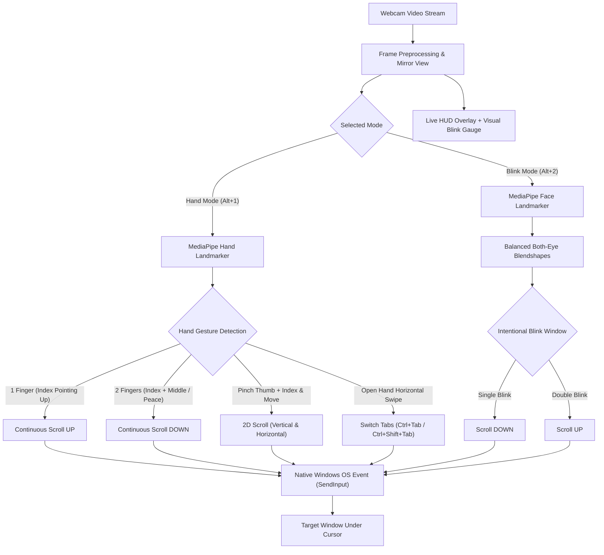

# AirScroll

> **Touchless laptop navigation using a standard webcam.**  
> AirScroll runs 100% locally with Python, OpenCV, MediaPipe Tasks, and native Windows input automation.

---

## Quick Start (Copy & Paste into Terminal)

```powershell
.\run.bat
```

Or with PowerShell directly:
```powershell
if (Test-Path .\AirScroll) { cd AirScroll }
.\.venv\Scripts\python.exe main.py
```

---

## Architecture Flowchart



---

## Features & Supported Gestures

| Gesture / Action | Trigger | OS Response |
|---|---|---|
| **Scroll UP (1 Finger)** | Show 1 finger (Index pointing up ☝️) | Continuous smooth scroll up |
| **Scroll DOWN (2 Fingers)** | Show 2 fingers (Index + Middle pointing ✌️) | Continuous smooth scroll down |
| **2D Grab & Scroll** | Pinch thumb + index together & move hand | Drag-scroll vertically or horizontally |
| **Next Tab** | Swipe open hand quickly to the right | `Ctrl + Tab` |
| **Previous Tab** | Swipe open hand quickly to the left | `Ctrl + Shift + Tab` |
| **Single Blink** | Close eyes for 0.08s - 0.85s once | Scroll down |
| **Double Blink** | Two quick blinks within 0.48s | Scroll up |

> **Pointer Requirement:** Windows sends scroll events to the window located directly beneath your mouse cursor. Keep your mouse cursor placed over the document, PDF, or browser tab you want to scroll.

---

## Global Keyboard Shortcuts (`Alt + Key`)

Control AirScroll globally with simple, single-modifier **`Alt + Key`** combinations:

| Shortcut | Action |
|---|---|
| `Alt + 1` | Switch to **Hand Mode** (1 finger, 2 fingers, pinch, swipe) |
| `Alt + 2` | Switch to **Blink Mode** (with live on-screen blink meter) |
| `Alt + =` | Increase scroll speed / sensitivity (`+0.25x`) |
| `Alt + -` | Decrease scroll speed / sensitivity (`-0.25x`) |
| `Alt + 0` | Reset sensitivity to default (`1.0x`) |
| `Alt + Right` / `Alt + N` | Switch to Next Tab (`Ctrl + Tab`) |
| `Alt + Left` / `Alt + B` | Switch to Previous Tab (`Ctrl + Shift + Tab`) |
| `Alt + P` | Pause / Resume gesture tracking |
| `Alt + Q` | Quit application and release webcam |
| `Esc` | Quit when preview window is focused |

*(Legacy `Ctrl + Shift + Alt + Key` combinations remain supported as backups).*

---

## Configuration & Tuning

All parameters are configured in [`airscroll/config.py`](file:///c:/Users/rudra/Downloads/AirScroll_starter/AirScroll/airscroll/config.py):

* **Camera Selection:** Change `CAMERA_INDEX = 0` or run `python test_camera.py` to auto-detect and select your camera.
* **Finger Scroll Speed:** Adjust `FINGER_SCROLL_INTERVAL` (default `0.07s`).
* **Eye Blink Accuracy:** Adjust `BLINK_START_SCORE` (default `0.50`) and `BLINK_RELEASE_SCORE` (default `0.28`).
* **Pinch Sensitivity:** Adjust `PINCH_START_RATIO` (default `0.38`) and `PINCH_RELEASE_RATIO` (default `0.52`).
* **Swipe Sensitivity:** Adjust `SWIPE_MIN_DISTANCE` (default `0.18`) and `SWIPE_COOLDOWN_SECONDS` (default `0.60s`).

---

## Project Structure

```text
AirScroll/
├── airscroll/
│   ├── config.py          # Central thresholds, camera & model configs
│   ├── gestures.py        # 1-finger, 2-finger, pinch, swipe, & blink controllers
│   ├── hotkeys.py         # Global Alt+Key shortcuts listener
│   ├── model_manager.py   # MediaPipe task models downloader & setup
│   └── state.py           # Thread-safe application state
├── models/                # Downloaded task models (hand_landmarker, etc.)
├── main.py                # Main webcam loop, HUD rendering & event dispatch
├── test_camera.py         # Interactive utility to test and select webcams
├── requirements.txt       # Dependencies (mediapipe, opencv, pyautogui, pynput)
├── setup.bat              # Windows setup script
└── run.bat                # Windows launch script
```

---

## Privacy & Safety

* **100% Local:** Frames are processed entirely in memory; no video is ever recorded or transmitted.
* **Corner Fail-Safe:** Move your pointer to the top-left corner of your screen at any time to trigger a safety pause.
* **Instant Pause:** Press `Alt + P` to pause tracking immediately.
