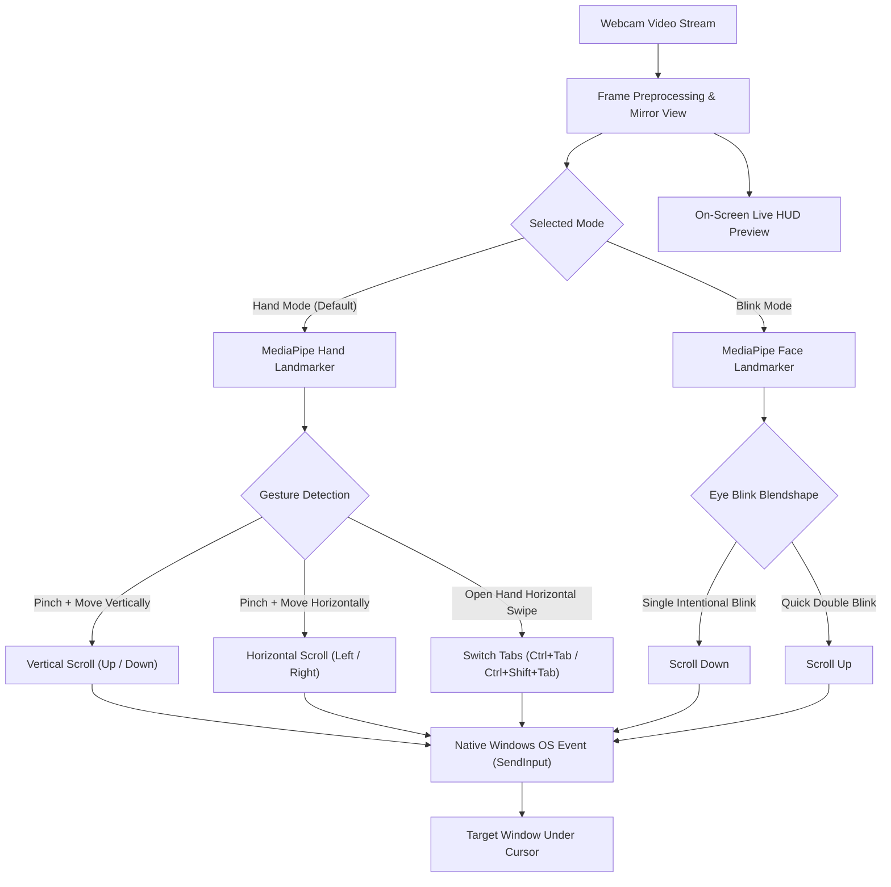

# AirScroll

> **Touchless laptop navigation using a standard webcam.**  
> AirScroll runs 100% locally with Python, OpenCV, MediaPipe Tasks, and native Windows input automation.

---

## Architecture Flowchart



---

## Features & Supported Gestures

| Gesture / Action | Trigger | OS Response |
|---|---|---|
| **Vertical Scroll** | Pinch thumb + index finger & move hand up/down | Scrolls document up or down |
| **Horizontal Scroll** | Pinch thumb + index finger & move hand left/right | Scrolls horizontally |
| **Next Tab** | Swipe open hand quickly to the right | `Ctrl + Tab` |
| **Previous Tab** | Swipe open hand quickly to the left | `Ctrl + Shift + Tab` |
| **Single Blink** | Close eyes for 0.1s - 0.7s once | Scrolls down |
| **Double Blink** | Two quick blinks within 0.58s | Scrolls up |

> **Pointer Requirement:** Windows sends scroll events to the window located directly beneath your mouse cursor. Keep your mouse cursor placed over the document, PDF, or browser tab you want to scroll.

---

## Quick Start

### 1. Automated (One-Click)
1. Double-click **`AirScroll/setup.bat`** (installs dependencies into `.venv`).
2. Double-click **`AirScroll/run.bat`** to launch AirScroll.

### 2. Terminal (PowerShell / CMD)
```powershell
cd AirScroll
py -m venv .venv
.\.venv\Scripts\python.exe -m pip install -r requirements.txt
.\.venv\Scripts\python.exe main.py
```

---

## Global Keyboard Shortcuts

Control AirScroll globally without needing to bring the preview window into focus:

| Shortcut | Action |
|---|---|
| `Ctrl + Shift + Alt + 1` | Switch to **Hand Pinch** mode |
| `Ctrl + Shift + Alt + 2` | Switch to **Blink** mode |
| `Ctrl + Shift + Alt + =` | Increase scroll speed / sensitivity (`+0.25x`) |
| `Ctrl + Shift + Alt + -` | Decrease scroll speed / sensitivity (`-0.25x`) |
| `Ctrl + Shift + Alt + 0` | Reset sensitivity to default (`1.0x`) |
| `Ctrl + Shift + Alt + Right` | Switch to Next Tab (`Ctrl + Tab`) |
| `Ctrl + Shift + Alt + Left` | Switch to Previous Tab (`Ctrl + Shift + Tab`) |
| `Ctrl + Shift + Alt + P` | Pause / Resume gesture tracking |
| `Ctrl + Shift + Alt + Q` | Quit application and release webcam |
| `Esc` | Quit when the preview window is focused |

---

## Configuration & Tuning

All parameters are configured in [`AirScroll/airscroll/config.py`](file:///c:/Users/rudra/Downloads/AirScroll_starter/AirScroll/airscroll/config.py):

* **Camera Selection:** Change `CAMERA_INDEX = 0` or run `python test_camera.py` to auto-detect and select your camera.
* **Scroll Speed:** Adjust `DEFAULT_SENSITIVITY` or `HAND_SCROLL_STEP_DISTANCE`.
* **Pinch Sensitivity:** Adjust `PINCH_START_RATIO` (default `0.38`) and `PINCH_RELEASE_RATIO` (default `0.52`).
* **Swipe Sensitivity:** Adjust `SWIPE_MIN_DISTANCE` and `SWIPE_COOLDOWN_SECONDS`.

---

## Privacy & Safety

* **100% Local:** Frames are processed in memory and never stored or uploaded.
* **Fail-Safe:** Move your mouse pointer to the top-left corner of your screen at any time to trigger PyAutoGUI's safety pause.
* **Instant Pause:** Press `Ctrl + Shift + Alt + P` to pause tracking immediately.
